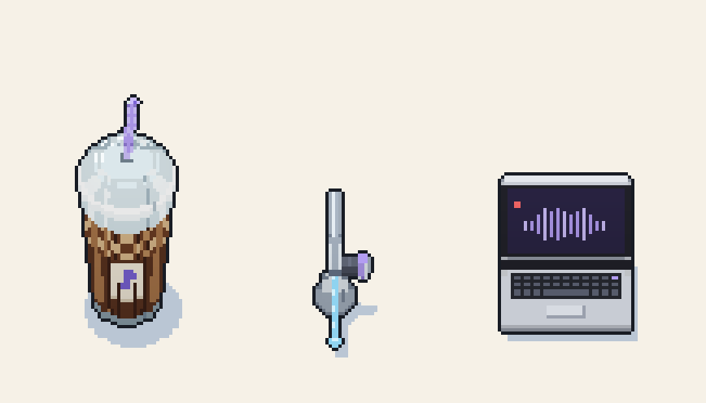

# sprite stacking 試作

[danielwh2/sprite-stacking](https://github.com/danielwh2/sprite-stacking)（MIT）を使って、
オトグラシの「3つの音」の小物（コップ・水・キーボード）を回せるドット絵にした試作です。



- `build.py` … 4面図をPythonで描き、上流のスライサーで輪切りに彫る
- `out/<name>/views.png` … 4面図（上・横・前・後ろ）
- `out/<name>/slices.png` … 輪切りストリップ（左が地面）
- `out/<name>/check.png` … スライサーの確認シート
- `demo.html` … 触って回せるデモ（`demo.template.html` にストリップを埋め込んだもの）

## 再生成

スライサーはリポジトリに含めていません。取得してパスを渡します。

```bash
git clone --depth 1 https://github.com/danielwh2/sprite-stacking /tmp/sprite-stacking
python3 build.py --slicer /tmp/sprite-stacking/skills/sprite-stacking/scripts/views_to_slices.py
```

`--viewer` を付けると、上流のビューア（Scene / Play モード付き）も `out/<name>/viewer.html` に出ます。

## やってみて分かったこと

- 4面図は上下中央で並べる。下揃えにすると、背の低い上面図が別の行と判定されて順番が入れ替わる。
- 上面図の色は「上に何もない面」に塗られる。ストローの筋を上面図に描くと、フタの上に斑点として写る。
- 薄い板（ノートPCの画面）は4px厚にする。3pxだと中央の行が裏面の色になり、回すと表に縞が出る。
- 4面の重なりでは細くできない部分（蛇口の水流）は、彫ったあとにコードで削って直している。
